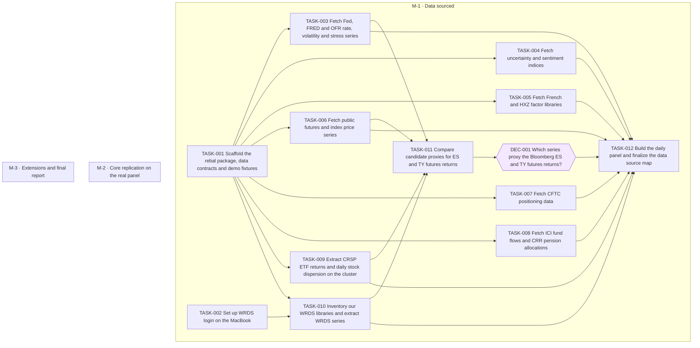

# Replicate Harvey–Mazzoleni–Melone (2026), The Unintended Consequences of Rebalancing

Goal `hmm-rebalancing` · format `goal/v2`. Live status is derived from GitHub and git and is
never written here: run `goal status hmm-rebalancing` or `goal tui`.

Reproduce every exhibit of Harvey, Mazzoleni and Melone (2026) from WRDS, tape-kit and public data, with a clear record of the data the paper needs, the source the authors used, and the proxy we actually use.

## Context, scope and non-goals

**Paper.** Harvey, Mazzoleni and Melone (2026), "The Unintended Consequences of Rebalancing" (SSRN, January 14, 2026).
- **Files:** the PDF is at the repo root; OCR text is in `ocr/`.
- **Planner's reading:** [`paper-notes.md`](paper-notes.md) holds the data inventory (D1–D28), the methods, every exhibit with its target numbers, and the open ambiguities. Every task cites it.
- **The paper in brief:** it builds two daily rebalancing signals (Threshold and Calendar) from a simulated 60/40 portfolio of S&P 500 and 10-year Treasury futures. It shows that they predict next-day stock-minus-bond returns.

**Data we have.**
- **WRDS** (Wharton Research Data Services) subscription. You log in from the MacBook; never from the cluster.
- **tape-kit data** on the SLURM cluster and the CEMFI PC:
  - CRSP CIZ daily stock file, 1925–2026, including ETFs and the CRSP index returns `vwretd` and `sprtrn`.
  - SpiderRock stock and option trades and quotes. These are intraday; the paper needs none of them.
- **Public sources:** we use these as proxies for the vendor data (mainly Bloomberg) that the authors used.

**Scope.**
1. Fetch and document every dataset.
2. Build one daily panel.
3. Reproduce every quantitative exhibit:
   - M-2: the core regressions, costs and strategy.
   - M-3: the extensions that need extra data.
4. Compare each result with the paper.

**Non-goals.**
- **Data we cannot get:** FEARS (private), ANcerno (licensed, discontinued), the 3:30 PM check (asset-manager data) and the qualitative survey material (D28). We document them as "not available" and skip their columns.
- **Writing:** we do not write a new paper or LaTeX.

**Possible M-3 extensions** (the M-3 planner decides):
- Extend the sample to 2025/2026 (footnote 32).
- Rerun the paper's 3:30 PM check (footnote 28) with tape-kit SpiderRock SPY 1-minute bars. They exist from 2018, on the CEMFI PC only.

## Shared conventions (every task follows these)

**Package.** Python package `rebal` in `src/rebal/`, managed by `uv` (`pyproject.toml` at the repo root). Run commands with `uv run python3 -m rebal.<module>` and test with `uv run pytest`. TASK-001 creates the scaffold. Follow the `python-script-creation` skill for CLI modules and the `duckdb-guidelines` skill for DuckDB.

**Fetchers.**
- One module per source: `src/rebal/fetch/<source>.py`, run as `uv run python3 -m rebal.fetch.<source>`.
- Each fetcher is idempotent: it overwrites its own output and nothing else.
- Each fetcher validates what it wrote: columns, date range, no duplicate dates.

**Data storage.** There are two classes, so licensed data never enters git:
- **Public, redistributable** (Fed, FRED, OFR, CFTC, French, EPU, ADS, SF Fed, ICI, CRR, global-q): committed under `data/public/<source>/` as CSV, each file under 20 MB.
- **Licensed or terms-restricted** (WRDS, CRSP via tape-kit, Yahoo, MSCI): stored under `$REPLICATE_DATA_DIR/licensed/<source>/`, never committed.
  - The default is `~/data/replicate` on the MacBook.
  - The cluster copy lives under `/mnt/slurm-beegfs/Users/j-vill36/replicate-data/`.
  - Processed files go to `$REPLICATE_DATA_DIR/processed/`.

**Source cards.**
- Each fetch task writes one source card, `docs/data/cards/<source>.md`. It records the URL or WRDS table, the download date, the license class, each series and its units, the transforms, the coverage, and known problems.
- `docs/data/sources.md` is the master map, with one row per paper dataset (D1–D28). TASK-001 creates it; after that, only TASK-012 edits it.

**Contracts.** These are written by TASK-001; cite them, never paraphrase them:
- `docs/contracts/daily_panel.md`: the panel schema.
- `docs/contracts/signals.md`: the signal frame schema.
- `docs/contracts/exhibits.md`: output names and formats.

**Demo mode.**
- `rebal.demo` (TASK-001) makes a synthetic panel and a signal frame with planted effects.
- Every analysis module has `--demo` and a test that recovers a planted effect and finds about zero for a zero effect.

**Exhibits.** One module per exhibit group in `src/rebal/exhibits/`.
- Real outputs go to `output/tables/<id>.csv` and `output/figures/<id>.pdf`, and are committed.
- Demo outputs go to `output/demo/`, which is git-ignored.

**Method choices.** Where the paper is ambiguous (paper-notes §5), each task writes its choice and reason in `docs/methods/<topic>.md`. Where it is cheap, the choice is a CLI flag.

**Cluster.** Follow the `cluster` skill and cluster-kit (`CLUSTER_REMOTE_BASE` comes from the untracked `.env`). Run at most one SLURM job per task at a time.

## Data plan: what the paper needs, what we use

`docs/data/sources.md` is the authoritative map once TASK-001 merges, and TASK-012 finalizes it. "Exact" means the same series from a public mirror. "Proxy" means a different series that stands in for it.

| D | Paper needs (authors' source) | We use | Class | Task |
|---|---|---|---|---|
| D1 | E-mini S&P 500 futures return (Bloomberg ES1/ES2) | Chosen in DEC-001. Candidates: CRSP SPY total return minus T-bill; Yahoo `ES=F` with roll-day correction | proxy | 006, 009, 011 |
| D2 | 10-year T-note futures return (Bloomberg TY1/TY2) | Chosen in DEC-001. Candidates: GSW 7- or 10-year zero/par return minus T-bill; CRSP 10-year fixed-term Treasury index (WRDS); IEF; Yahoo `ZN=F` | proxy | 003, 006, 009, 010, 011 |
| D3 | Holiday calendar (days when ES1 and TY1 are both missing) | Trading days of the chosen proxies; 2001-09-12..14 marked closed | proxy | 012 |
| D4 | S&P 500 Total Return Index (Bloomberg) | Yahoo `^SP500TR`; check against CRSP SPY | exact / proxy | 006, 009 |
| D5 | Bloomberg U.S. Aggregate TR (Bloomberg) | CRSP Mutual Funds VBMFX daily return (WRDS); AGG ETF from 2003 | proxy | 009, 010 |
| D6 | MSCI ACWI ex USA Net TR USD (Bloomberg) | msci.com end-of-day index download if available; else CRSP ETFs (VEU, ACWX, EFA) | exact / proxy | 006, 009 |
| D7 | 3-month T-bill (not named) | FRED `DTB3` | exact | 003 |
| D8 | VIX (Bloomberg) | FRED `VIXCLS` (CBOE) | exact | 003 |
| D9 | MOVE (Bloomberg) | Yahoo `^MOVE`; if the history is short, fill the gap with a documented proxy | exact / proxy | 006 |
| D10 | EPU daily (Baker, Bloom and Davis) | policyuncertainty.com | exact | 004 |
| D11 | ADS index (Philadelphia Fed) | Philadelphia Fed, latest vintage | exact | 004 |
| D12 | Daily news sentiment (SF Fed) | SF Fed | exact | 004 |
| D13 | BEX risk aversion and uncertainty | Bekaert's public data page | exact | 004 |
| D14 | FEARS (private, from the authors) | not available; Table D.9 FEARS column skipped | none | 004 |
| D15 | ARA (Da, Hua, Hung and Peng) | the authors' public file if one exists; else skipped | exact / none | 004 |
| D16 | Long-sample equity return (French) | Kenneth French daily data library | exact | 005 |
| D17 | Long-sample 10-year return (GSW, Fed) | Fed `feds200628.csv` (GSW), with our yield-to-return method | exact source | 003 |
| D18 | Russell 1000, 2000, 1000 Value, 1000 Growth (unnamed) | CRSP ETFs IWB, IWM, IWD, IWF (total return); Yahoo `^RUI` `^RUT` `^RLV` `^RLG` price indices as a check | proxy | 006, 009 |
| D19 | CFTC COT, weekly | CFTC legacy COT and TFF history files | exact | 007 |
| D20 | CFTC LTPos one-time report (2009–2011) | CFTC website, if still hosted | exact | 007 |
| D21 | ANcerno trades | not available, unless TASK-010 finds it in our WRDS subscription | none | 010 |
| D22 | ICI weekly flows | ICI estimated long-term flows files | exact | 008 |
| D23 | CRR Public Plans Data | publicplansdata.org | exact | 008 |
| D24 | Factors: Carhart, FF5, HXZ q | French library; global-q.org | exact | 005 |
| D25 | CRSP daily stocks (for ivol) | tape-kit CRSP CIZ on the cluster | exact | 009 |
| D26 | BofA GFSI Liquidity Risk (vendor) | OFR Financial Stress Index, liquidity category | proxy | 003 |
| D27 | Dollar-scaling constants (Fed Z.1, CRS, Census, ICI) | the same public reports, cited in `docs/methods/costs.md` | exact | 016 |
| D28 | Surveys and memos | not replicated; documentation only | none | 001 |

## Risks and open questions

- **ES/TY proxy quality is the main risk.** Cash-market proxies (SPY, GSW yields) close at different times than futures: equities at 16:00 ET vs ES at 16:15; bonds at 15:00. A Treasury futures contract tracks a bond of about 6.5 years duration, not 10. TASK-011 measures these gaps; DEC-001 picks the proxy.
- **WRDS login is a manual step (TASK-002).** No `~/.pgpass` exists on the MacBook today. TASK-010 cannot start until the login works without a prompt.
- **Our WRDS subscription is unknown.** TASK-010 lists the libraries we can read. If WRDS has futures data, MSCI, ANcerno or Russell indices, TASK-011 and TASK-012 use them.
- **Public URLs change.** Fetchers fail loudly. A worker records a moved or vanished source in its card and reports it in the outcome; it does not invent data.
- **Paper ambiguities** (paper-notes §5) are settled in code with documented defaults, not with new decision nodes, unless a worker finds a choice that moves headline results. Such a worker raises a `Goal-Decision`.
- **Untracked files in the main checkout.** `pyproject.toml` and `.env` are untracked there. TASK-001 commits a tracked `pyproject.toml`. Before you pull TASK-001, remove or stash the untracked copy.
- **Assumptions:**
  - The MacBook runs all public downloads and WRDS queries.
  - The cluster runs only the CRSP stock-level work (TASK-009).
  - All analysis is daily time-series work that runs in seconds to minutes on the MacBook.

## Plan structure

<!-- goal:graph:start -->

<!-- goal:graph:end -->

## Worker protocol

For an agent executing exactly one task of this goal:

1. Work only on your task, in your own branch and worktree, branched from `origin/main`.
2. Read `tasks/TASK-NNN.md` (the spec), the outcomes of the tasks it depends on, and the
   accepted decisions it depends on. Never edit specs, other tasks, decisions or `goal.yaml`.
3. After your first commit, open a draft PR into `main` whose body contains the line
   `Goal-Task: hmm-rebalancing/TASK-NNN`. Write the body with real newlines.
   Use `gh pr create --body-file FILE` or `gh pr edit --body-file FILE`.
   If the repo has several remotes, resolve `origin` with `git remote get-url origin`.
   For a GitHub origin, use `gh pr create --repo <origin OWNER/NAME> --body-file FILE`.
   Pass the same `--repo <origin OWNER/NAME>` to every other `gh pr` command.
4. Do the work and run the spec's Verify commands.
5. Write `tasks/TASK-NNN.outcome.md` with an `## Acceptance` checklist (each item followed by
   its evidence) and a `## Summary` (what, how, deviations, verified revision, proposed
   follow-ups). Commit it in the same PR.
6. Mark the PR ready for review when checks pass or none are configured.
   Failing or pending checks block delivery unless repository or owner rules explicitly
   override that requirement. Follow those rules for allowed evidence sources. Never merge.
7. Blocked by a missing decision, access or data? Explain it in the outcome, add the line
   `Goal-Blocked: <reason>` to the draft PR body, and stop. For a material decision, also
   write `## Decision request` in the outcome with the question, options and trade-offs,
   and your recommendation under `### Recommendation` (omit it if you have none). Add
   `Goal-Decision: <one-line question>` to the draft PR body, commit and push, then stop
   through exit (B). Refresh or `goal sync` creates a decision in the Inbox. Under
   `decide: experts`, the committee gives opinions. A copilot or orchestrator shell records
   the final call with `goal decide`; the ledger names `experts` as the decider.
   The owner can accept or reject any open decision as the human. After acceptance,
   the Resume task action in `:` resumes the task with the decision in its resume note.
